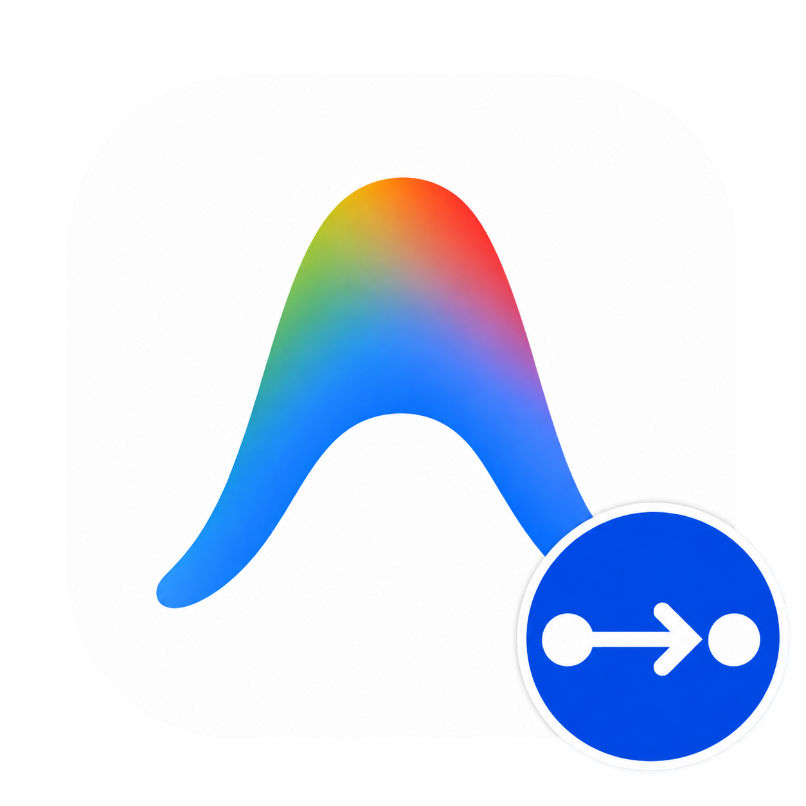
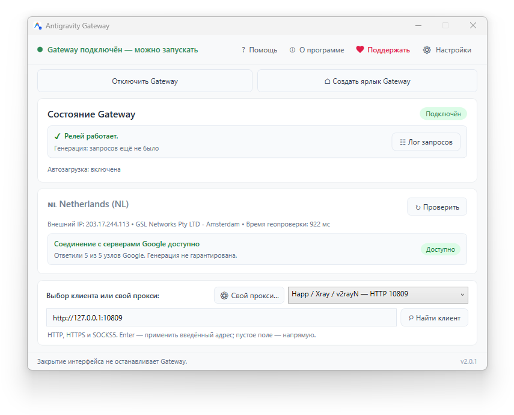

# Antigravity with any Secure Connection: Stable connectivity without drops or Error 400

[Русский](README.md) | [English](README.en.md)

**Antigravity Gateway** connects Antigravity, Antigravity IDE and CLI through YOUR preferred secure connection (Happ, Hiddify, v2ray, Xray, Clash, Nekoray, Sing-box, AdGuard, WireGuard and others), providing stable connectivity without drops or Error 400.

**Version:** 2.0.6  
**Author:** [CodoMagia](https://github.com/codomagia)  
**Community & Support (Telegram):** [t.me/codomagia/2](https://t.me/codomagia/2)  
**Support the author:** [Boosty](https://boosty.to/codomagia/donate)  
**Video review:** [YouTube](https://www.youtube.com/watch?v=ufLqwjEoKAE)

Download in [Releases](https://github.com/codomagia/Antigravity-Gateway/releases).

---

## Screenshot

---

### Why use Antigravity Gateway?

- **Launch as usual:** after connecting Antigravity Gateway, launch IDE, AGI and Antigravity as usual.
- **Background operation:** close the window or minimize it to the tray while the connected gateway keeps running; you can also enable the interface to start in the tray at Windows sign-in independently.
- **Your choice:** use an available secure connection or the built-in proxy client.
- **Does not modify files** belonging to Antigravity or any other files. Antivirus software does not produce false positives with this method, so you do not need to add the program to antivirus exclusions.
- **Traffic isolation:** Antigravity Gateway routes Antigravity requests through the selected connection without changing browser or other application settings.

---

### Key Features:

- **Client discovery:** find available local proxy clients.
- **One-click connection:** configure applications and gateway startup.
- **Diagnostics:** external IP and country, Google server checks and an event log.
- **Desktop shortcut:** open Antigravity Gateway settings quickly.
- **Portable mode:** optionally keep settings next to the application.
- **Management console:** connect, disconnect, choose a proxy and check diagnostics using a menu or commands.

---

### Quick Start:

> **Updating:** disconnect Antigravity Gateway in the old version and close its interface before replacing files. Connect the gateway again after updating.

1. Download Antigravity-Gateway-2.0.6-windows-x64.zip from [Releases](https://github.com/codomagia/Antigravity-Gateway/releases).
2. Unpack the archive into a permanent folder and start your secure connection.
3. Run Antigravity Gateway.exe.
4. Select a client or enter a proxy address and click **«Подключить Gateway»** (Connect Antigravity Gateway).
5. Open the desired application normally. If Antigravity, IDE or CLI are already running, close their processes in Task Manager and restart them, or restart your PC. Click **«Отключить Gateway»** to disconnect.

> **Protocol tip:** if an HTTP proxy does not work well, try a SOCKS5 proxy provided by your client.

> **Note:** No installation required. Do not run from inside the ZIP. Apps may need restarting; in some cases Windows may need restarting.

---

## Settings and diagnostics

Settings are stored in the AntigravityGateway user profile folder by default. For portable settings, disconnect Antigravity Gateway, close its window and copy that folder beside the application as data.

---

## Requirements

Linux console builds are available for x64 and ARM64. Startup and generation were tested on Ubuntu x64; the ARM64 build has been cross-compiled only. The Linux archives include usage instructions.

- **OS:** Windows 10 or Windows 11 (x64).
- **Framework:** .NET Framework 4.7.2 or newer.
- **Applications:** Antigravity, Antigravity IDE or CLI.
- **Connection:** a secure connection, a running proxy client, or an HTTP, HTTPS or SOCKS5 proxy.

---

## License

Copyright © 2026 CodoMagia. All rights reserved.
