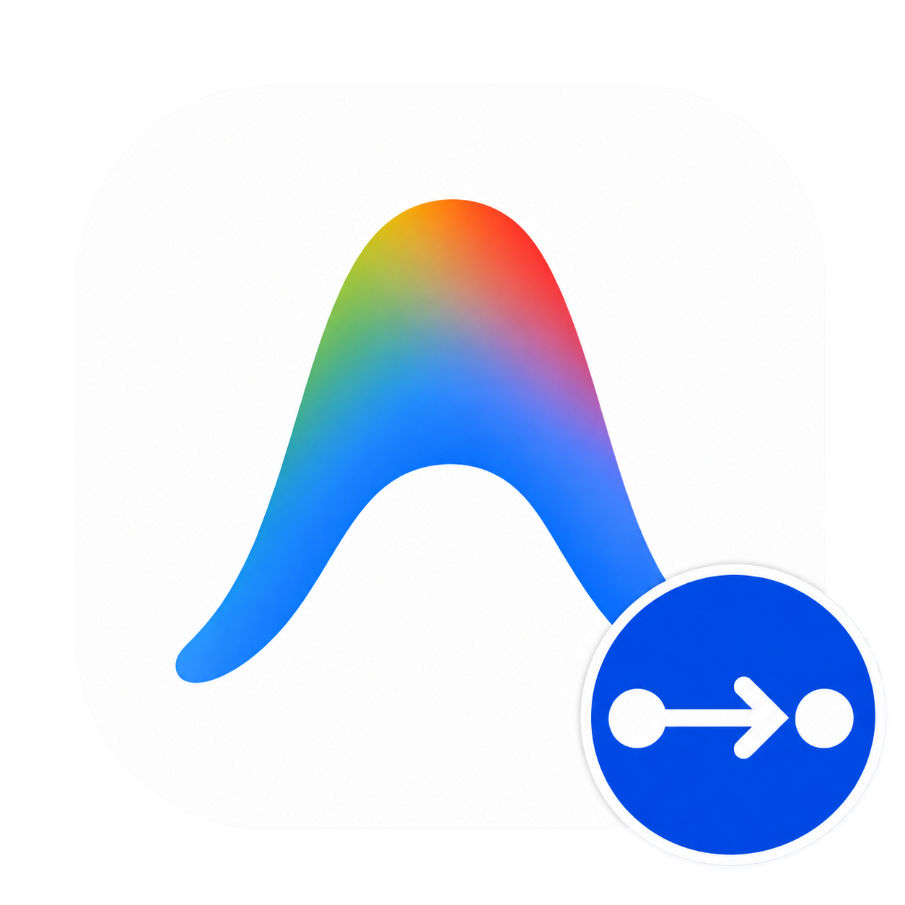
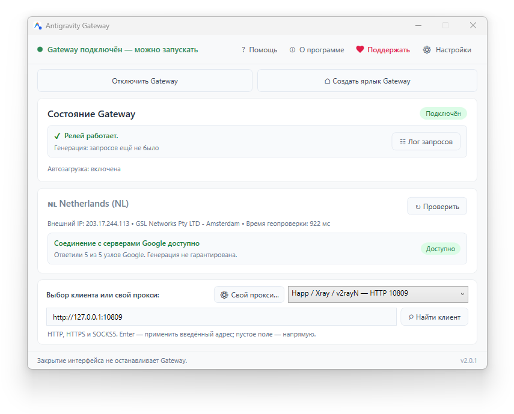

# Antigravity в России с любым (Защищённым соединением): стабильное соединение без разрывов и ошибок 400

[Русский](README.md) | [English](README.en.md)

**Antigravity Gateway** — это шлюз для работы Antigravity, Antigravity IDE и CLI через ВАШЕ любое удобное вам защищённое соединение (Happ, Hiddify, v2ray, Xray, Clash, Nekoray, Sing-box, AdGuard, WireGuard и др.), обеспечивая стабильное соединение без разрывов и ошибок 400.

**Версия:** 2.0.6  
**Автор:** [CodoMagia](https://github.com/codomagia)  
**Обсуждение и помощь (Telegram):** [t.me/codomagia/2](https://t.me/codomagia/2)  
**Поддержать автора:** [Boosty](https://boosty.to/codomagia/donate)  
**Видеообзор:** [YouTube](https://www.youtube.com/watch?v=ufLqwjEoKAE)

Скачать в разделе [Releases](https://github.com/codomagia/Antigravity-Gateway/releases).

---

## Внешний вид

---

### Зачем нужен Antigravity Gateway?

Antigravity Gateway помогает использовать выбранное защищённое соединение для Antigravity, IDE и CLI. Также можно указать собственный или купленный прокси.

### Почему стоит использовать Antigravity Gateway?

- **Обычный запуск:** после подключения Antigravity Gateway запускайте IDE, AGI и Antigravity обычным способом.
- **Работа в фоне:** закрытие интерфейса не останавливает подключённый шлюз; в настройках можно отдельно включить запуск интерфейса в трее при входе в Windows.
- **Ваш выбор:** используйте доступное вам защищённое соединение или встроенный прокси-клиент.
- **Не модифицирует файлы** Antigravity или какие-либо другие. Антивирусы при таком способе не дают ложных срабатываний, вам не придётся добавлять программу в исключения антивируса.
- **Изоляция трафика:** Antigravity Gateway направляет через выбранное соединение запросы Antigravity; настройки браузеров и других программ он не меняет.

---

### Главные возможности:

- **Автопоиск клиента** — поиск доступного локального прокси-клиента.
- **Подключение в один клик** — настройка приложений и автозапуска шлюза.
- **Экспресс-диагностика** — внешний IP и страна, проверка серверов Google и журнал событий.
- **Ярлык на Рабочем столе** — быстрое открытие настроек Antigravity Gateway.
- **Portable режим** — возможность хранить настройки рядом с программой.
- **Консоль управления** — подключение, отключение, выбор прокси и диагностика через меню или команды.

---

### Быстрый старт:

> **Обновление:** перед заменой файлов отключите Antigravity Gateway в старой версии и закройте интерфейс. После обновления подключите шлюз заново.

1. Скачайте архив Antigravity-Gateway-2.0.6-windows-x64.zip в разделе [Releases](https://github.com/codomagia/Antigravity-Gateway/releases).
2. Распакуйте архив в постоянную папку и запустите своё защищённое соединение.
3. Запустите Antigravity Gateway.exe.
4. Выберите клиент или введите свой прокси, затем нажмите **«Подключить Gateway»**.
5. Запустите нужное приложение обычным способом. Если Antigravity, IDE или CLI уже открыты, закройте их процессы через диспетчер задач и запустите снова либо перезагрузите ПК. Для остановки нажмите **«Отключить Gateway»**.

> **Совет по протоколам:** если HTTP-прокси работает нестабильно, попробуйте SOCKS5-прокси вашего клиента.

> **Примечание:** установка не требуется. Не запускайте программу прямо из ZIP-архива. Приложениям может потребоваться перезапуск; иногда потребуется перезапуск Windows.

---

## Настройки и диагностика

Настройки по умолчанию хранятся в папке профиля AntigravityGateway. Для переносимого режима отключите шлюз, закройте окно и скопируйте папку настроек рядом с программой под именем data.

---

## Системные требования

Для Linux доступны консольные сборки x64 и ARM64. Запуск и генерация проверены на Ubuntu x64; сборка ARM64 проверена компиляцией. Инструкция по запуску находится внутри Linux-архивов.

- **ОС:** Windows 10 или Windows 11 (x64)
- **Платформа:** .NET Framework 4.7.2 или новее (встроен в Windows 10/11)
- **Приложения:** Antigravity, Antigravity IDE или CLI
- **Соединение:** защищённое соединение, работающий прокси-клиент или собственный HTTP, HTTPS либо SOCKS5-прокси.

---

## Лицензия

Copyright © 2026 CodoMagia. Все права защищены.
